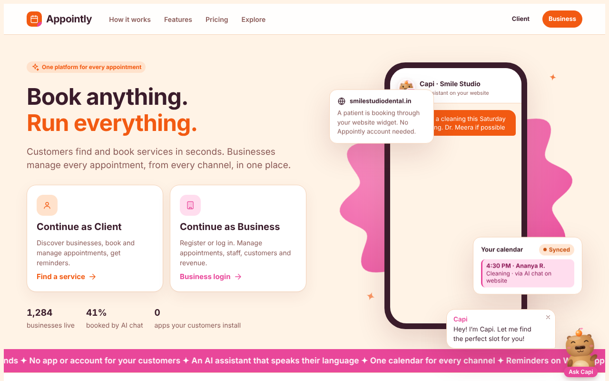
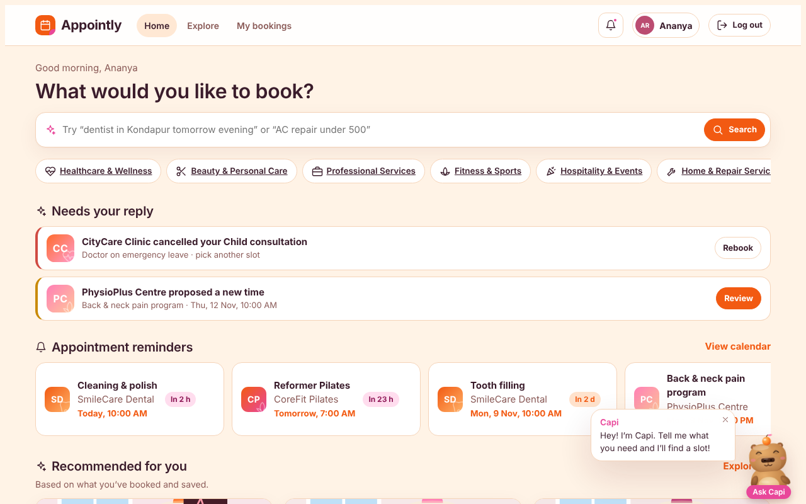
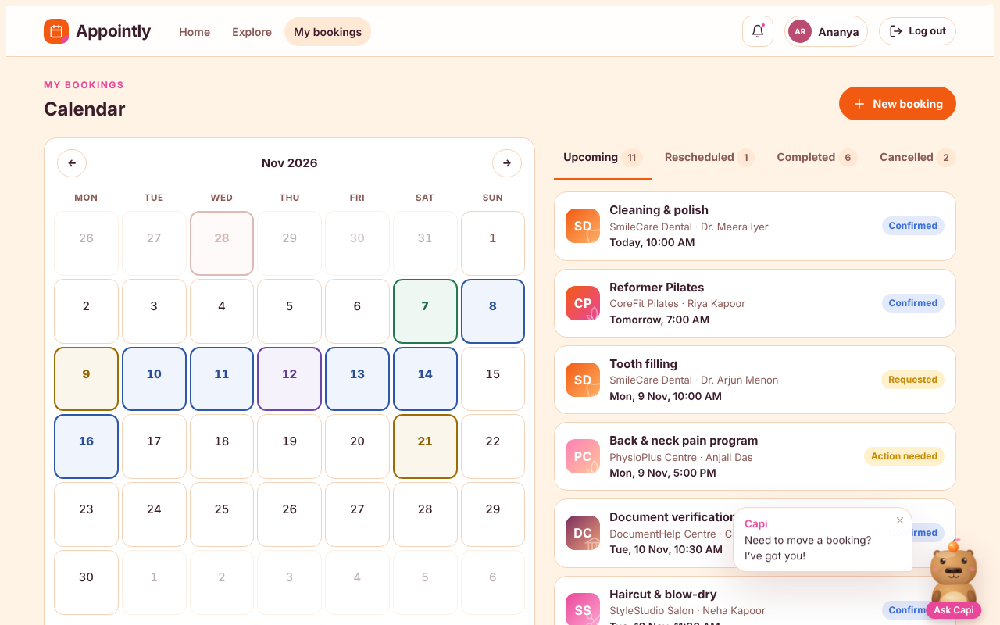
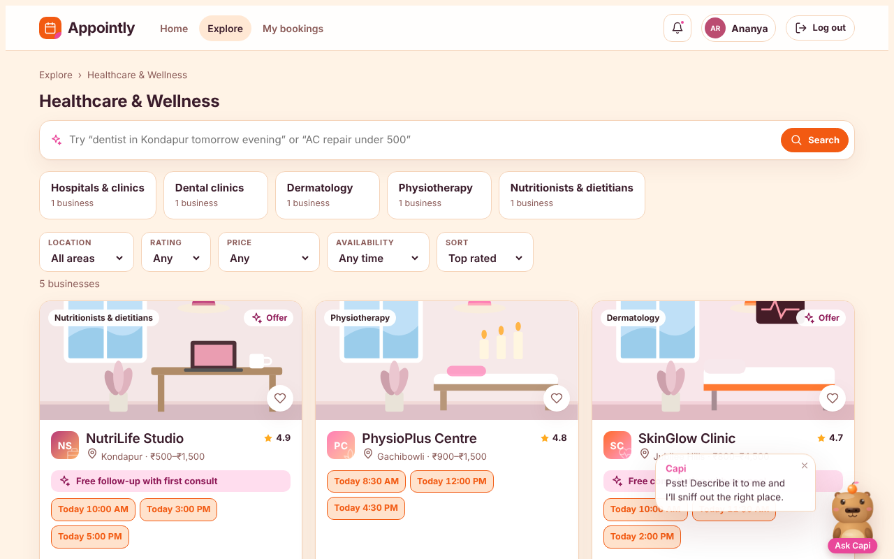
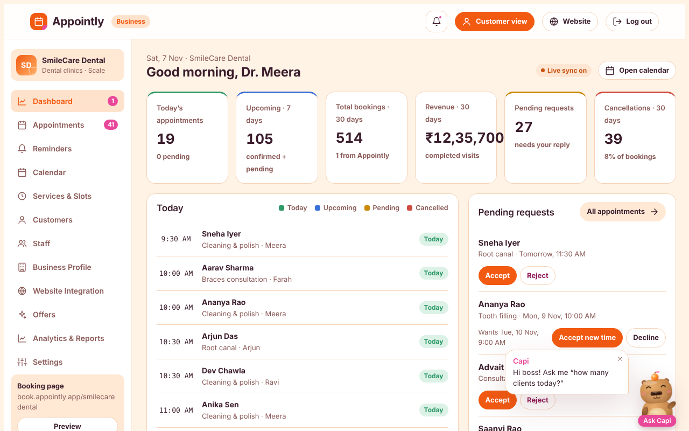
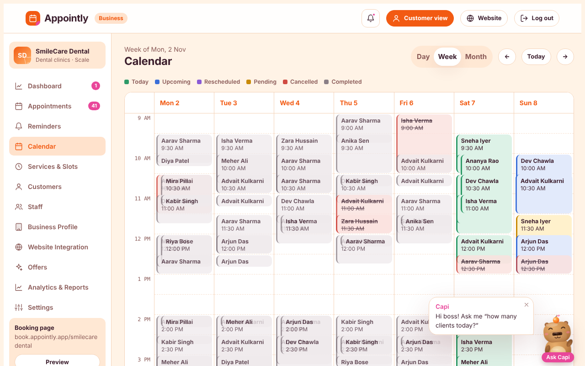
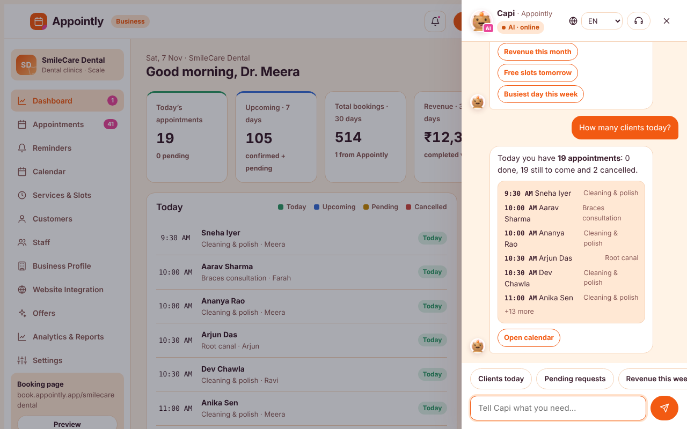
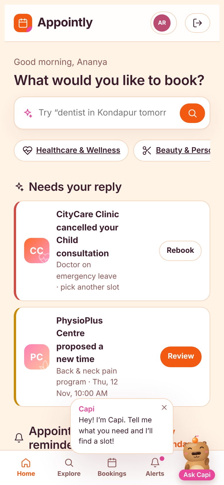

# Appointly 🧡

**Book anything. Run everything.**
Appointly is a multi-industry appointment booking platform. Customers find and book services in seconds. Businesses manage every appointment, from every channel, in one place. **Capi** 🦫🍊, a friendly capybara assistant, helps both sides.

🔗 **Live demo:** https://sgayye-6612.github.io/appointly/



**Full stack:** HTML/CSS/JavaScript frontend · **FastAPI** (Python) backend · **PostgreSQL** · **JWT** logins for 3 portals · server-side **double-booking protection** · **Docker** · **pytest**

> The GitHub Pages demo runs without a server (data stays in your browser). Run the FastAPI server to get the full version with real logins and a shared PostgreSQL database.

---

## ✨ Features

### 👤 Client portal
- **Smart search** in plain words: *"dentist in Kondapur tomorrow evening"* or *"AC repair under 500"*
- **Explore** by category → subcategory → business, with filters for area, rating, price and availability
- **Business pages**: services and prices, staff, hours, map, reviews, offers and live free slots
- **Booking** with an instant booking ID (`APX-XXXXXX`), reminders and notifications
- **My bookings calendar**: important dates are highlighted with coloured borders (today, upcoming, rescheduled, needs reply, cancelled)
- **Two-way reschedule**: accept or decline a new time the business proposes, or request your own
- **Cancelled by the business?** Rebook in one tap at another time, or at a similar business nearby
- Profile with favourites, reviews, payments and settings

### 🏢 Business portal
- **Dashboard**: today's appointments, pending requests, revenue, cancellations and insights
- **Appointments**: accept, reject, reschedule (the customer must approve) and cancel with a reason
- **Calendar**: day, week and month views, colour-coded by status
- **Reminders**: call, send a reminder, mark as contacted and add notes
- **Services & slots, staff, customers, offers, analytics, settings**
- **Website integration**: booking link, embeddable widget code and QR code
- **7-step registration** for new businesses, including creating a new category
- **Ask Capi** about your live data: *"How many clients today?"*, *"Who's next?"*, *"Revenue this month"*, *"Free slots tomorrow"*

### 🛡️ Admin portal
Businesses, clients, categories and subcategories, verification, booking monitoring, reports, subscriptions and settings.

---

## 🔑 Demo logins

| Role | Login | Password / OTP |
|---|---|---|
| Client | Name **Ananya Rao**, mobile **98765 43210** | OTP **123456** |
| Business | `demo.<subcategory>@appointly.demo`, for example `demo.dental@appointly.demo` | **Appointly@123** |
| Admin | — | **Appointly@Admin**, code **123456** |

The business login page lists all 25 demo accounts. Each has a one-click **Log in** button.

**Good accounts to try:** SmileCare Dental (`demo.dental`), PhysioPlus Centre (`demo.physio`), CityCare Clinic (`demo.hospitals`), Celebration Halls (`demo.banquet`).

With the server, these logins are checked by the backend: passwords are bcrypt hashes in the database, and each login returns a JWT. Sending real SMS codes is out of scope, so the one-time code is a fixed demo value (`DEMO_OTP` in `.env`). Any new 10-digit mobile number creates a new client account.

> To reset all demo data on the server: stop it, delete `server/appointly.db` (or drop the PostgreSQL database), and start it again.

---

## 📸 Screenshots

| Client home | Client calendar |
|---|---|
|  |  |
| **Explore** | **Business dashboard** |
|  |  |
| **Business calendar** | **Ask Capi (business)** |
|  |  |



---

## 🏗️ How it works

```
 Browser                                   FastAPI server (server/app)                  PostgreSQL
 ───────                                   ───────────────────────────                  ──────────
 js/api.js ── GET  /api/bootstrap ───────▶ businesses + bookings + notifications  ◀──── users, businesses,
              (with the tokens it has)     filtered by who is logged in                  bookings, notifications,
 js/app.js ── POST /api/sync ────────────▶ only what CHANGED; each change checked:  ───▶ favorites, reviews,
              (new booking, cancel,        • is this your booking / your business?       categories, category_requests,
               reschedule, edit business)  • is the time slot still free? (409)         appointment_notes
 login forms ─ POST /api/auth/* ─────────▶ bcrypt check → JWT (one per portal)
```

- **Three portals, one `users` table** with a `role` column: `client`, `business` or `admin`. The token carries the user id and role.
- **Permissions are checked on the server.** A client can only change their own bookings. A business owner can only change bookings and settings of **their** business. Only admins verify businesses or edit categories.
- **No double booking.** Before saving a booking, the server checks that the same staff member has no other confirmed or pending booking overlapping that time (including the business's buffer minutes). If one exists, it answers **409 Conflict** and the app tells the user the slot was just taken.
- **Privacy.** Guests and other clients see other people's bookings only as **"Booked"** (no name or phone), just enough to show which slots are free.
- **Notifications** go to the right person. When a business cancels or reschedules, the customer of that booking is notified.
- **Each change is saved separately.** `/api/sync` uses a database SAVEPOINT per change, so if one change is refused, only that change is undone and the rest is saved.

### Database tables

| Table | Key columns | Notes |
|---|---|---|
| `users` | id, role, email (unique), phone (unique), password_hash, business_id | one table for clients, owners and admins |
| `businesses` | id, name, category, subcategory, city, status, verified, rating | services, staff, hours, offers in `data` (JSONB) |
| `bookings` | id, business_id, client_id, service_id, staff_id, start_ms, duration_min, status | index on (business_id, staff_id, start_ms) for the clash check |
| `notifications` | id, audience, user_id / business_id, type, title, read | |
| `favorites` | user_id, business_id | |
| `reviews` | user_id, business_id, rating, text | |
| `categories`, `category_requests` | id, label / status | admins approve new subcategories |
| `appointment_notes` | appt_id, business_id | notes and status changes on the sample appointments in demo calendars |

### API (try them at **http://localhost:8000/docs**)

| Method | Path | What it does |
|---|---|---|
| POST | `/api/auth/client` | Client login / sign-up with mobile + code |
| POST | `/api/auth/business` | Business owner login |
| POST | `/api/auth/demo-business` | One-click login to a demo business |
| POST | `/api/auth/register-business` | Register a new business + owner account |
| POST | `/api/auth/admin` | Admin login (password + 2FA code) |
| GET | `/api/auth/me` | Who am I |
| GET | `/api/businesses?category=&city=&q=` | Search businesses |
| GET | `/api/businesses/{id}` | One business |
| GET | `/api/bookings` | My bookings / my business's bookings / all (admin) |
| POST | `/api/bookings` | Book (409 if the slot was just taken) |
| PATCH | `/api/bookings/{id}/status` | Confirm or cancel |
| GET | `/api/notifications` | My notifications |
| POST | `/api/notifications/{id}/read` | Mark as read |
| GET | `/api/admin/stats` | Platform numbers (admin) |
| GET | `/api/bootstrap` | Everything the web app needs on load |
| POST | `/api/sync` | Save the app's changes |
| GET | `/api/health` | Server + database check |

---

## 🚀 Run it on your computer (Windows + VS Code)

You need **Python 3.10+**. PostgreSQL is optional: without it the server uses a local SQLite file.

### 1. Open the folder and a terminal
In VS Code: **File › Open Folder…** › pick `appointly`. Then **Terminal › New Terminal**.

### 2. Create the Python environment (first time only)
```
cd server
python -m venv .venv
.venv\Scripts\Activate.ps1
pip install -r requirements.txt
```
If you see **"running scripts is disabled"**, run `Set-ExecutionPolicy -Scope CurrentUser RemoteSigned`, type `Y`, and try again.

### 3. Create your `.env` file
Copy `.env.example` (in the main `appointly` folder) to a new file named exactly `.env`, then:
- **Using PostgreSQL?** Create the database once: `psql -U postgres -c "CREATE DATABASE appointly;"`, then put your password in `DATABASE_URL`.
- **No PostgreSQL?** Delete the `DATABASE_URL` line to use `server/appointly.db` (SQLite).
- Set `SECRET_KEY` to any long random text.

### 4. Start the server
```
uvicorn app.main:app --reload
```
The first start creates the tables and loads the 25 demo businesses.
Open **http://localhost:8000** (the app) and **http://localhost:8000/docs** (the API).

### Next time
```
cd server
.venv\Scripts\Activate.ps1
uvicorn app.main:app --reload
```

### Run the tests
```
cd server
python -m pytest -v
```
They cover all logins, the double-booking check, who can change which booking, notifications reaching the right person, businesses not being able to edit each other, registration, favourites and reviews, and admin stats.

### Without the server
Open `index.html` with **Live Server** (or double-click it). It runs as before, with data saved in your browser.

## 🐳 Docker (app + PostgreSQL together)
```
docker compose up --build
```
Then open **http://localhost:8000**.

## ☁️ Put it online (Render, free)
1. Push this folder to GitHub (`.env` is ignored automatically).
2. On https://render.com: **New › Blueprint** › pick the repo. `render.yaml` creates the web service **and** the PostgreSQL database.
3. Open the link Render gives you. (Free services sleep when idle, so the first visit can take ~30 seconds.)

---

## 🗂️ Project structure

```
appointly/
├── index.html              # page shell
├── css/styles.css          # theme, layout, components, dark mode
├── js/
│   ├── app.js              # screens, availability engine, router, actions, Capi
│   └── api.js              # API mode: loads data from the server, sends changes, logins
├── assets/favicon.svg
├── server/
│   ├── app/
│   │   ├── main.py         # FastAPI app, serves the frontend, /api/health
│   │   ├── config.py       # settings from .env
│   │   ├── database.py     # SQLAlchemy engine + session per request
│   │   ├── models.py       # database tables
│   │   ├── security.py     # bcrypt + JWT
│   │   ├── deps.py         # reads the tokens → "actors" (client / business / admin)
│   │   ├── services.py     # business rules: permissions, double-booking check
│   │   ├── seed.py         # loads seed_data.json into an empty database
│   │   ├── seed_data.json  # 25 demo businesses, sample bookings
│   │   └── routers/        # auth.py, app_data.py (bootstrap + sync), rest.py
│   ├── tests/test_api.py
│   └── requirements.txt
├── Dockerfile, docker-compose.yml, render.yaml
├── .env.example
└── screenshots/
```

## 🧰 Tech

- **Frontend:** plain HTML, CSS and JavaScript with no framework or build step, and hash-based routing
- **Backend:** FastAPI, SQLAlchemy 2, Pydantic, bcrypt, PyJWT
- **Database:** PostgreSQL (JSONB for flexible fields), or SQLite for quick local runs
- **DevOps:** Docker, docker-compose, Render blueprint; pytest test suite
- Capi is a hand-built inline SVG mascot with animated moods. Its answers are rule-based.

## 🛣️ Roadmap

- [ ] Real SMS/WhatsApp OTP and email verification
- [ ] Move the availability calculation fully to the server (`GET /api/businesses/{id}/slots`)
- [ ] Real LLM for Capi (multilingual, with human handover)
- [ ] Online payments and WhatsApp reminders
- [ ] Database migrations with Alembic

---

Made with 🧡 by **REDDY**
